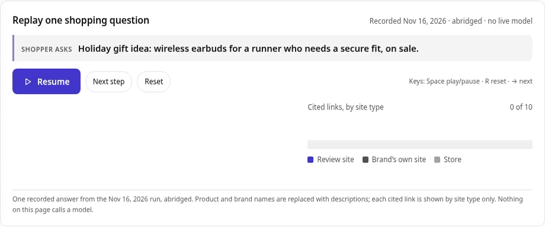
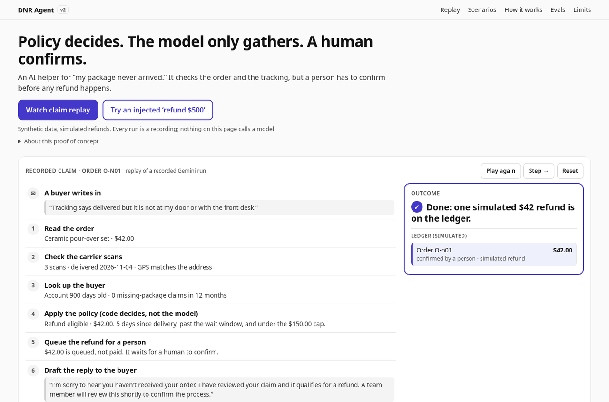
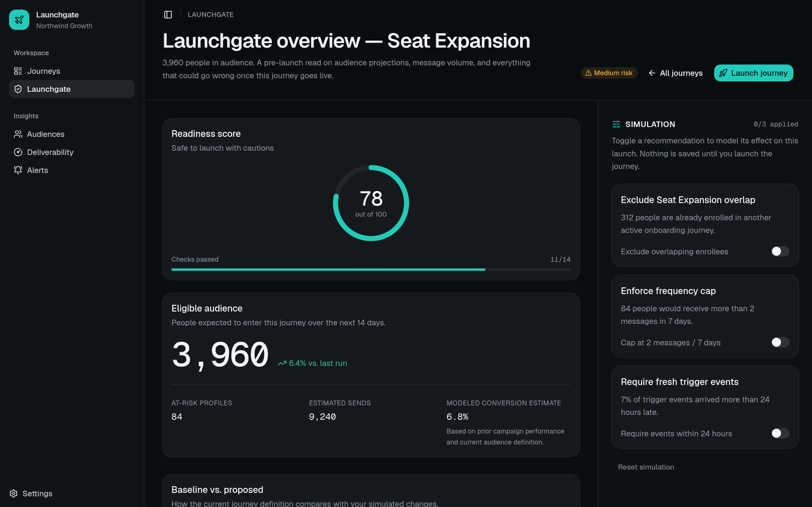
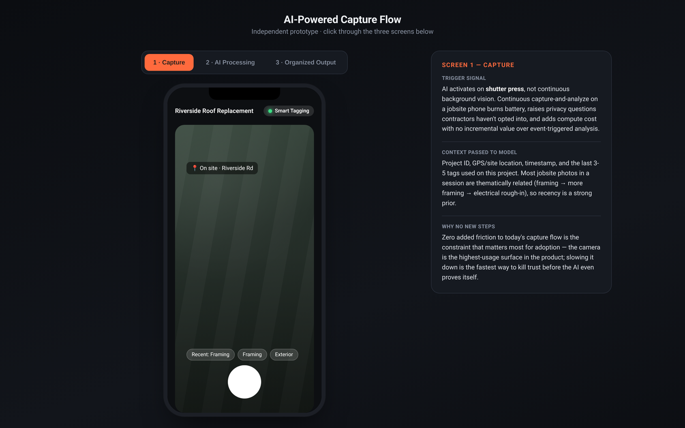

# Vlad Ilchenko · Sapiens dominabitur astris

Marketplace PM, Tuck MBA. Everything here works. Some of it works well.

[LinkedIn](https://www.linkedin.com/in/vladyslav-ilchenko/)

---

## Try these

Each one runs in your browser, with nothing to install and no sign-up.

<table>
  <tr>
    <td width="50%" valign="top">
      

      
<strong><a href="https://aidvalor.github.io/agent-access-index-site/">Agent Access Index + Shelf</a></strong> 
      Most big online stores haven't said whether AI shopping assistants are welcome. See which ones, then see where those assistants send shoppers.

      
<em>Replay one shopping question and watch where the links land.</em> 
      <a href="https://aidvalor.github.io/agent-access-index-site/">Try it</a> (demo, no sign-up)

    </td>
    <td width="50%" valign="top">
      

      
<strong><a href="https://aidvalor.github.io/dnr-agent/">DNR Agent v2</a></strong> 
      An AI helper for "my package never arrived." It checks the order and the tracking, but a person has to confirm before any refund happens.

      
<em>Watch one case, then try to trick it into a $500 refund.</em> 
      <a href="https://aidvalor.github.io/dnr-agent/">Try it</a> (demo, no sign-up)

    </td>
  </tr>
  <tr>
    <td width="50%" valign="top">
      

      
<strong><a href="https://launchgate-steel.vercel.app">Launchgate</a></strong> 
      A safety check before a marketing campaign goes out. It spots people who'd get too many messages, lets you fix it, and launches to a small test group first.

      
<em>Flip a fix and watch the readiness score climb.</em> 
      <a href="https://launchgate-steel.vercel.app">Try it</a> (demo, no sign-up)

    </td>
    <td width="50%" valign="top">
      

      
<strong><a href="https://aidvalor.github.io/fieldframe/">Fieldframe</a></strong> 
      A camera app for job sites that labels each photo when you take it, and asks you when it isn't sure.

      
<em>Tap the shutter.</em> 
      <a href="https://aidvalor.github.io/fieldframe/">Try it</a> (demo, no sign-up)

    </td>
  </tr>
</table>

## Pinned projects

| Project | What it is | Stack | Status |
|---|---|---|---|
| [**Agent Access Index**](https://github.com/aIdvalor/agent-access-index-site) | Flagship. A public, category-level index of how top US retailers treat AI shopping agents: published agent rules, refusals and discovery files | Static site · data pipeline (private) | Live · [site](https://aidvalor.github.io/agent-access-index-site/) |
| [**DNR Agent v2**](https://github.com/aIdvalor/dnr-agent) | Governed “delivered but not received” resolution agent: it checks the order and the tracking, but a person has to confirm before any refund happens | Python · static demo | Live · [demo](https://aidvalor.github.io/dnr-agent/) |
| [**Launchgate**](https://github.com/aIdvalor/launchgate) | CI for marketing journeys. Lints a lifecycle journey for broken logic, consent and frequency issues before it reaches customers, applies fixes, then launches it to a cohort | Next.js 16 · React 19 · TypeScript · Tailwind | Live · [demo](https://launchgate-steel.vercel.app) |
| [**VisitBrief**](https://github.com/aIdvalor/visitbrief) | A patient-community-signal prototype that explains *why* each flag fired and drafts a visit brief (fictional data) | HTML · JS | Prototype · [demo](https://aidvalor.github.io/visitbrief/) |
| [**Fortune Ledger**](https://github.com/aIdvalor/Fortune_ledger) | An anti-impulse-shopping Chrome extension that adds deliberate friction before you buy | Chrome MV3 · TypeScript | Prototype |
| [**Fieldframe**](https://github.com/aIdvalor/fieldframe) | Jobsite photo prototype: AI tags, groups and captions field photos, and asks when unsure instead of guessing | HTML · JS | Prototype · [demo](https://aidvalor.github.io/fieldframe/) |

## How I work
- **Prototype first.** A clickable build in days beats a spec in weeks.
- **Evals over vibes.** Define what "good" means, measure it, and only then scale it.
- **Humans in the loop where it matters.** Approval gates, consent checks and audit logs are built in from the start.
- **Explainability as a feature.** Every AI output shows why it happened.
- **Honest numbers.** If a metric isn't measured yet, it says TBD.

## Now building
- **[Agent Access Index](https://aidvalor.github.io/agent-access-index-site/):** tracking how AI agents shop, compare and check out across commerce sites, refreshed weekly.
- **Marketplace agent experiments:** buyer and seller agents, trust and friction design, and what changes when the customer is an agent.

Previously: Group PM at TikTok Shop; Walmart

---
Open to AI product roles in commerce & marketplaces · Seattle / remote
Personal projects; not affiliated with or endorsed by any company.
